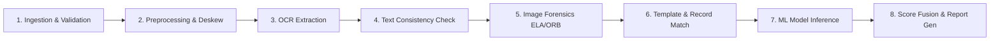

# DESIGN SYSTEM & UI/UX SPECIFICATION
## AI-Based Detection of Fake or Manipulated Academic Certificates

**Document Version:** 1.0.0  
**Target Audience:** Autonomous AI Coding Agents, Frontend Engineers, UX Architects  
**Authoritative Scope:** Complete Web Interface Implementation Blueprint  
**Locked Core Stack:** Next.js (App Router), TypeScript (Strict), Tailwind CSS, shadcn/ui, Motion.dev, Lucide Icons, Recharts  

---

# 1. Executive Summary & Design Philosophy

This document is the **single authoritative construction manual** for the web frontend of the **AI-Based Detection of Fake or Manipulated Academic Certificates** platform. Every visual token, component hierarchy, interaction state, layout split, animation curve, and screen flow defined here corresponds directly to the system architecture and capabilities detailed in [`docs/PRD_AI_Certificate_Verification.md`](file:///Users/apple/Codes/AI-Based-Detection-of-Fake-or-Manipulated-Academic-Certificates/docs/PRD_AI_Certificate_Verification.md), [`docs/SRD_AI_Certificate_Verification.md`](file:///Users/apple/Codes/AI-Based-Detection-of-Fake-or-Manipulated-Academic-Certificates/docs/SRD_AI_Certificate_Verification.md), [`docs/Design_Docs_AI_Certificate_Verification.md`](file:///Users/apple/Codes/AI-Based-Detection-of-Fake-or-Manipulated-Academic-Certificates/docs/Design_Docs_AI_Certificate_Verification.md), and [`docs/specs/02_PIPELINE_DATA_CONTRACTS.md`](file:///Users/apple/Codes/AI-Based-Detection-of-Fake-or-Manipulated-Academic-Certificates/docs/specs/02_PIPELINE_DATA_CONTRACTS.md).

### 1.1 The Core Design Philosophy: "Minimal Enterprise"
The product serves high-stakes decision makers: university registrars, admissions evaluators, corporate talent acquisition teams, scholarship committees, and state verification boards. The interface must inspire unquestionable confidence in its evidentiary integrity.

- **Engineered Restraint:** Clean typography, precision lines, controlled micro-interactions, and tight information density. Visual styling takes inspiration from premier developer and infrastructure platforms (e.g., Linear, Stripe, Vercel, Datadog) rather than consumer apps.
- **Evidence-Driven, Not Verdict-Driven:** The system **never** proclaims an absolute legal verdict (e.g., "This certificate is 100% fake"). Instead, it presents an **AI-Assisted Authenticity & Risk Assessment** underpinned by auditable forensic indicators, confidence intervals, and spatial region highlights.
- **Progressive Disclosure of Technical Depth:** High-level summaries (Overall Risk Band, Key Flags) are visible at a glance. Forensic depth (Error Level Analysis heatmaps, ORB copy-move cluster lines, character baseline regression residuals) is accessible in secondary collapsible panels without overwhelming non-technical reviewers.

### 1.2 Anti-AI-Slop Directives (Strict Prohibitions)
To ensure the interface feels like an authentic enterprise security platform and not a toy AI demo, frontend implementations **must strictly obey** these negative constraints:
1. **NO Neon Gradients:** No purple-to-cyan hero gradients, glowing button borders, or iridescent background meshes.
2. **NO Decorative AI Clichés:** No floating brains, robot avatars, magic wands, sparkles (`✨`), or pulsing neural network backgrounds.
3. **NO Synthetic "AI Scanning" Gimmicks:** The certificate processing screen must strictly reflect real backend pipeline stages (`Ingestion` $\to$ `Preprocessing` $\to$ `OCR` $\to$ `Forensics` $\to$ `ML Inference` $\to$ `Score Fusion`). No looping laser sweep lines that bear no relation to server progress.
4. **NO Arbitrary Padding / Floating Blobs:** No 120px empty gutters, oversized 32px pill buttons, or excessive nested card borders.
5. **NO Unexplained Scoring:** Never display an unanchored percentage (e.g., "78% Genuine") without an adjacent breakdown showing the exact weights of text consistency, forensic anomalies, and ML inference.

---

# 2. Brand Personality & Emotional Architecture

| Trait | UI Expression | Anti-Pattern (What to Avoid) |
| :--- | :--- | :--- |
| **Trustworthy** | Neutral slate palette, verifiable source tags for every field, clear timestamps, model audit tags. | Vague green checkmarks without explanations; unsubstantiated binary verdicts. |
| **Precise** | Monospaced figures for dates, register numbers, and coordinates; sharp 1px borders; calibrated data tables. | Loose rounded badges, inconsistent line heights, fuzzy drop shadows. |
| **Calm & Objective** | Desaturated status indicators, balanced risk bands (Slate/Amber/Rose), clear explanatory microcopy. | Blaring alarm sirens, flashing red banners, panic-inducing modal popups. |
| **Technically Sophisticated** | High-precision pan/zoom document canvas, interactive SVG region overlays, SHAP feature importance charts. | Static low-res image previews with non-interactive text blocks. |

---

# 3. Technology & UI Library Ownership Strategy

To prevent visual fragmentation and spaghetti dependencies, each library in the locked stack has strict, mutually exclusive domain ownership:

```text
┌────────────────────────────────────────────────────────────────────────┐
│                        Next.js 14+ (App Router)                        │
├────────────────────────────────┬───────────────────────────────────────┤
│          shadcn/ui             │               Motion.dev              │
│  - Form Controls (Input, Form) │  - Route transitions                  │
│  - Overlays (Dialog, Sheet)    │  - Pipeline stage progress transitions│
│  - Data Display (Table, Badge) │  - Canvas highlight focus micro-anims │
│  - Layout Shell (Tabs, Scroll) │  - Drawer slide-ins & accordions      │
├────────────────────────────────┼───────────────────────────────────────┤
│          Lucide Icons          │                Recharts               │
│  - Semantic status glyphs      │  - Risk score gauge breakdown         │
│  - Action triggers (Zoom, Pan) │  - Historical verification volume     │
│  - File type / entity badges   │  - Forensic anomaly radar/bar charts  │
├────────────────────────────────┴───────────────────────────────────────┤
│                  Tailwind CSS (Semantic Design Tokens)                 │
└────────────────────────────────────────────────────────────────────────┘
```

### 3.1 Component Ownership Rules
1. **shadcn/ui (Base Application Primitives):**
   - **Allowed:** `Button`, `Input`, `Select`, `Dialog`, `Sheet`, `DropdownMenu`, `Tooltip`, `Badge`, `Tabs`, `Table`, `Card`, `Separator`, `Progress`, `Skeleton`, `Alert`, `ScrollArea`.
   - **Customization Rule:** Replace default zinc with custom enterprise slate palette (`hsl(var(--primary))`, etc.). Remove oversized rounded radii in favor of `--radius: 0.375rem` (6px).
2. **Motion.dev (Purposeful Motion Only):**
   - **Allowed:** Linear pipeline progress transitions, tab cross-fades, document canvas view centering, accordion expansion, and table row insertions.
   - **Prohibited:** Continuous spinning loops, bouncy spring physics, hover shakes, or distracting background animations.
3. **Lucide Icons (Semantic Precision):**
   - Default stroke width: `1.75px` (refined).
   - Standard sizes: `14px` (inline/table metadata), `16px` (button/input icons), `20px` (section headers/navigation), `24px` (empty state anchors).
4. **Recharts (Analytical Data Visualization):**
   - Use customized tooltips adhering to the design token surface; disable default pastel palettes in favor of semantic verification tokens.

---

# 4. Design Tokens & Visual Foundations

## 4.1 Color System (HSL Architecture)

The system defines distinct, accessible Light and Dark themes. Neither theme relies on pure black (`#000000`) or pure white (`#ffffff`); both use calibrated slate tones to reduce optical fatigue during extended review sessions.

```css
/* ==========================================================================
   DESIGN TOKENS (globals.css)
   ========================================================================== */
@layer base {
  :root {
    /* Base Neutral Scale (Slate Precision) */
    --background: 210 20% 98%;          /* #f8fafc */
    --foreground: 222 47% 11%;          /* #0f172a */
    --card: 0 0% 100%;                  /* #ffffff */
    --card-foreground: 222 47% 11%;     /* #0f172a */
    --popover: 0 0% 100%;               /* #ffffff */
    --popover-foreground: 222 47% 11%;  /* #0f172a */
    --muted: 210 40% 96.1%;             /* #f1f5f9 */
    --muted-foreground: 215.4 16.3% 46.9%; /* #64748b */
    --border: 214.3 31.8% 91.4%;        /* #e2e8f0 */
    --input: 214.3 31.8% 91.4%;         /* #e2e8f0 */

    /* Brand Primary (Deep Executive Navy) */
    --primary: 222.2 47.4% 11.2%;       /* #0f172a */
    --primary-foreground: 210 40% 98%;  /* #f8fafc */

    /* Secondary & Accent */
    --secondary: 210 40% 96.1%;         /* #f1f5f9 */
    --secondary-foreground: 222.2 47.4% 11.2%;
    --accent: 217.2 32.6% 17.5%;        /* Subtle dark slate */
    --accent-foreground: 210 40% 98%;

    /* Semantic Verification & Risk Tokens */
    --risk-low: 142 71% 45%;            /* Emerald #16a34a - Clean / Low Risk */
    --risk-low-bg: 138 76% 97%;         /* Light green tint */
    --risk-low-border: 141 60% 84%;

    --risk-medium: 38 92% 50%;          /* Amber #f59e0b - Suspicious / Review */
    --risk-medium-bg: 48 96% 97%;       /* Light amber tint */
    --risk-medium-border: 45 93% 82%;

    --risk-high: 0 84% 60%;             /* Rose-Red #e11d48 - High Risk / Tampered */
    --risk-high-bg: 355 100% 97%;       /* Light rose tint */
    --risk-high-border: 354 70% 87%;

    --info: 217 91% 60%;                /* Blue #2563eb */
    --info-bg: 214 100% 97%;
    --info-border: 214 95% 87%;

    /* Spatial Canvas Overlays */
    --overlay-ela: 271 81% 56%;         /* Purple #9333ea for ELA anomaly */
    --overlay-copymove: 199 89% 48%;    /* Cyan #0284c7 for Copy-Move match */
    --overlay-font: 38 92% 50%;         /* Amber #f59e0b for Font mismatch */

    --radius: 0.375rem;                 /* 6px standard */
  }

  .dark {
    /* Base Neutral Scale (Dark Executive Slate) */
    --background: 222 47% 7%;           /* #090d16 Deep slate */
    --foreground: 210 40% 98%;          /* #f8fafc */
    --card: 222 47% 9%;                 /* #0f1422 Slightly elevated */
    --card-foreground: 210 40% 98%;
    --popover: 222 47% 9%;
    --popover-foreground: 210 40% 98%;
    --muted: 217 33% 14%;               /* #172033 */
    --muted-foreground: 215 20% 65%;    /* #94a3b8 */
    --border: 217 33% 17%;              /* #1e293b */
    --input: 217 33% 17%;

    /* Brand Primary (Crisp High-Contrast White/Slate) */
    --primary: 210 40% 98%;
    --primary-foreground: 222.2 47.4% 11.2%;

    --secondary: 217 33% 14%;
    --secondary-foreground: 210 40% 98%;
    --accent: 217 33% 20%;
    --accent-foreground: 210 40% 98%;

    /* Semantic Verification & Risk Tokens (Dark Adapted) */
    --risk-low: 142 70% 50%;            /* #22c55e */
    --risk-low-bg: 144 61% 10%;
    --risk-low-border: 144 50% 20%;

    --risk-medium: 38 92% 50%;          /* #f59e0b */
    --risk-medium-bg: 35 60% 12%;
    --risk-medium-border: 35 60% 22%;

    --risk-high: 0 84% 60%;             /* #f43f5e */
    --risk-high-bg: 355 60% 12%;
    --risk-high-border: 355 60% 24%;

    --info: 217 91% 60%;
    --info-bg: 217 50% 12%;
    --info-border: 217 50% 22%;
  }
}
```

### 4.2 Typography System

The typography hierarchy emphasizes clear scannability, legibility of certificate numbers, and unambiguous distinction between labels and extracted data.

- **Primary Sans Font:** `Geist Sans`, `Inter`, or system `-apple-system, BlinkMacSystemFont, "Segoe UI", Roboto, sans-serif`.
- **Monospace Code / Data Font:** `Geist Mono`, `JetBrains Mono`, or `ui-monospace, "SF Mono", monospace`. (Strictly required for certificate numbers, dates, hash values, coordinates, and bounding box coordinates).

| Token | CSS Class | Size / Line Height | Weight | Usage |
| :--- | :--- | :--- | :--- | :--- |
| `display` | `text-3xl font-semibold tracking-tight` | 30px / 36px | 600 | Verification summary risk band banner |
| `h1` | `text-2xl font-semibold tracking-tight` | 24px / 32px | 600 | Page titles (Dashboard, Verify, History) |
| `h2` | `text-lg font-medium tracking-tight` | 18px / 26px | 500 | Section headers, workspace pane titles |
| `h3` | `text-sm font-semibold uppercase tracking-wider` | 12px / 16px | 600 | Category dividers, table column headers |
| `body` | `text-sm font-normal` | 14px / 20px | 400 | General descriptions, narrative explanations |
| `body-sm` | `text-xs font-normal text-muted-foreground` | 12px / 16px | 400 | Metadata, helper texts, timestamps |
| `mono-data` | `font-mono text-xs font-medium tracking-tight` | 12px / 16px | 500 | Certificate numbers, extracted dates, register IDs |
| `metric-val`| `font-mono text-xl font-bold` | 20px / 24px | 700 | Numeric risk score (0–100), OCR confidence % |

---

## 4.3 Spacing, Surface & Radius System

- **Base Spacing Scale:** 4px grid (`p-1` = 4px, `p-2` = 8px, `p-3` = 12px, `p-4` = 16px, `p-6` = 24px, `p-8` = 32px).
- **Surface Elevation Hierarchy:**
  - `Level 0 (Background):` `bg-background`
  - `Level 1 (Card/Container):` `bg-card border border-border shadow-sm`
  - `Level 2 (Active/Hover/Popover):` `bg-popover border border-border shadow-md`
  - `Level 3 (Modal Dialog/Flyout):` `bg-card border border-border shadow-xl backdrop-blur-sm`
- **Border Radius:**
  - Base interactive elements (`Button`, `Input`, `Badge`): `rounded-md` (`6px`)
  - Container surfaces (`Card`, `Dialog`, `Table`): `rounded-lg` (`8px`)
  - Inner tags & pills: `rounded` (`4px`)

---

# 5. Motion & Animation System (Purpose-Driven)

Every animation in the platform must communicate state, structural continuity, or evidentiary focus.

### 5.1 Physics & Timing Curves
- **Standard Transition:** `duration: 0.15s, ease: "easeOut"` (tab switches, button presses).
- **Panel Slide-in:** `duration: 0.25s, ease: [0.16, 1, 0.3, 1]` (evidence panel reveal, drawer).
- **Focus Transition:** `duration: 0.35s, ease: [0.16, 1, 0.3, 1]` (document canvas zooming into a selected suspicious bounding box).
- **Respect `prefers-reduced-motion`:** If enabled, disable all spatial translations and limit transitions to instantaneous opacity cross-fades (`duration: 0.05s`).

### 5.2 The 8-Stage Certificate Processing Animation
When a certificate is uploaded, the processing modal/screen renders a live execution tracker mapped directly to backend task states. **No fake looping scanners are allowed.**



**Interaction Design:**
1. **Stage State Nodes:** Each stage renders an icon:
   - `PENDING:` Dim circle with muted outline.
   - `ACTIVE:` 14px rotating accent spinner (`animate-spin text-primary`).
   - `COMPLETED:` 14px check circle (`text-emerald-600 dark:text-emerald-400`).
   - `FAILED:` 14px alert circle (`text-rose-600 dark:text-rose-400`).
2. **Real-Time Telemetry Feed:** Below the stage tracker, display the active operation text (e.g., `"Executing Error Level Analysis at Q=90..."`, `"Evaluating 5 consistency rules against extracted student data..."`).
3. **Completion Transition:** Upon reaching `COMPLETED`, the modal smooth-fades (`opacity: 0, scale: 0.98`) and directs the router to `/verifications/{id}` with no jarring reload.

---

# 6. Global Information Architecture & Navigation

The navigation structure strictly mirrors the roles and permissions defined in [`docs/Design_Docs_AI_Certificate_Verification.md`](file:///Users/apple/Codes/AI-Based-Detection-of-Fake-or-Manipulated-Academic-Certificates/docs/Design_Docs_AI_Certificate_Verification.md):

```text
Application Root
├── /login                            # Auth entrypoint
├── /dashboard                        # Role-aware Overview
├── /verify                           # Single/Batch Document Upload & Ingestion
├── /verifications/[id]               # Primary Evidence Workspace
├── /verifications/[id]/report        # Printable / Exportable PDF Preview
├── /history                          # Auditable Verification Log Table
├── /templates                        # Institutional Template Registry (Admin/Inst)
├── /records                          # Institutional Student Records Database (Admin/Inst)
├── /analytics                        # Aggregate Verification & Anomaly Metrics
├── /users                            # User & RBAC Management (Sys Admin only)
└── /settings                         # Account, API Keys & Storage Preferences
```

### 6.1 Role-Based Access Matrix
| Navigation Item | Verifier / Reviewer | Institution Admin | System Administrator |
| :--- | :---: | :---: | :---: |
| **Dashboard** | View Own Activity | View Institution Activity | View Platform-Wide Activity |
| **Verify Certificate** | Full Access | Full Access | Full Access |
| **Verification Workspace** | Full Access | Full Access | Full Access |
| **Verification History** | Assigned Jobs Only | Institution Jobs | All Jobs |
| **Templates** | Read-only | Manage Own Templates | Manage All Templates |
| **Student Records** | Query Only | Manage Own Records | Manage All Records |
| **Analytics** | Individual Stats | Institution Stats | Full Platform Telemetry |
| **User Management** | Hidden | Manage Institution Staff| Manage All Users / Roles |

---

# 7. Core Screen Specifications

---

## Screen 7.1: Authentication (`/login`)
- **Layout:** Centered single-column card layout (`max-w-md`) over a subtle dotted grid background (`bg-dot-black/[0.05]`).
- **Components:**
  - Institution/Platform logo with title `"Academic Credential Verification System"`.
  - Subtitle: `"Enter authorized institutional credentials to access verification workspace."`
  - Username & Password inputs with floating label/error text.
  - Role indicator chip (auto-detected on credential entry).
  - Submit Button with loading state (`"Authenticating..."`).
- **Security UX:**
  - Clear notification banner if session expires (`"Session expired for security compliance. Please re-authenticate."`).
  - No credential autofill on public workstation toggle.

---

## Screen 7.2: Verifier & Operations Dashboard (`/dashboard`)
- **Layout:** Standard enterprise shell with collapsible 240px sidebar, 56px sticky header, and 12-column responsive grid content area.
- **Header Bar:** Active role badge, Institution affiliation label, global job notification bell, user profile popover.
- **Top Metric Strip (4 Stat Cards):**
  1. *Total Verified Today:* Numeric count with week-over-week trend indicator.
  2. *Flagged / High Risk Rate:* Percentage highlighted in muted amber/rose if above threshold.
  3. *Average Processing Latency:* E.g., `4.2s` (System Health indicator).
  4. *Pending Human Review Queue:* Number of certificates flagged with low OCR confidence or medium risk requiring manual review.
- **Main Section (Two-Column Split, 8 / 4):**
  - **Left (8 cols) - Recent Verification Activity Table:**
    - Columns: Document Name, Institution, Upload Date, OCR Conf %, Risk Band Badge, Action (`Inspect`).
  - **Right (4 cols) - Live Risk Distribution & Quick Verify:**
    - Mini drag-and-drop dropzone for immediate certificate verification.
    - Donut chart (`Recharts`) showing distribution of Low vs. Medium vs. High Risk assessments across the last 30 days.

---

## Screen 7.3: Certificate Upload & Verification Ingestion (`/verify`)
- **Layout:** Centered single-document / batch tabbed workspace (`max-w-4xl mx-auto`).
- **Drag & Drop Zone:**
  - Dotted 2px border (`border-dashed border-border hover:border-primary/50`).
  - Accepted file formats clearly stated: `PDF, PNG, JPG (Max 15MB)`.
  - Icon: `UploadCloud` (32px, `text-muted-foreground`).
  - Secondary button: `"Browse Files from Computer"`.
- **Pre-Upload Options Panel (Collapsible):**
  - *Optional Template Match:* Dropdown to select a known institutional template (e.g., `"Apex University - B.Tech 2020-2024 Layout"`).
  - *OCR Engine Selector:* Radio switch: `Fast Standard (Tesseract)` vs `High Accuracy Neural (EasyOCR)`.
- **Validation Error Handling:**
  - Oversized file (>15MB): Instant client-side rejection banner (`"File exceeds maximum permissible size of 15MB."`).
  - Corrupt or unsupported format (e.g., `.docx`): Rejection banner with allowed MIME types.

---

## Screen 7.4: The Verification Results Workspace (`/verifications/[id]`)
> **CRITICAL SCREEN:** This is the flagship user experience of the entire application.

```text
┌──────────────────────────────────────────────────────────────────────────────────────────────────┐
│ Top Bar: Certificate ID | Verifier | Timestamp | [Export PDF Report] [Re-Run Analysis]           │
├──────────────────────────────────────────────────────────────────┬───────────────────────────────┤
│ LEFT: Document Canvas Workspace (60% Desktop)                    │ RIGHT: Evidence Panel (40%)   │
│                                                                  │                               │
│ ┌──────────────────────────────────────────────────────────────┐ │ ┌───────────────────────────┐ │
│ │ Canvas Toolbar: [Zoom In] [Zoom Out] [Fit Page] [Rotate]     │ │ │ Overall Authenticity Score│ │
│ │ Layer Toggles: [x] OCR Bboxes  [x] Forensics  [x] Anomalies  │ │ │  [ 82.5 / 100 - HIGH RISK]│ │
│ ├──────────────────────────────────────────────────────────────┤ │ ├───────────────────────────┤ │
│ │                                                              │ │ │ Key Contributing Factors  │ │
│ │                  Interactive Document Image                  │ │ │  1. ELA Splice Anomaly    │ │
│ │                                                              │ │ │  2. Date Logic Mismatch   │ │
│ │       ┌──────────────┐                                       │ │ ├───────────────────────────┤ │
│ │       │ Suspicious   │ ◄─── Clickable SVG Overlay            │ │ │ Tabbed Deep Inspection:   │ │
│ │       │ Region #1    │      (Focuses Right Finding)          │ │ │ [Extracted Data]          │ │
│ │       └──────────────┘                                       │ │ │ [Forensic Checks]         │ │
│ │                                                              │ │ │ [Consistency Rules]       │ │
│ │                                                              │ │ │ [Template Match]          │ │
│ │                                                              │ │ └───────────────────────────┘ │
│ └──────────────────────────────────────────────────────────────┘ │                               │
└──────────────────────────────────────────────────────────────────┴───────────────────────────────┘
```

### 7.4.1 Left Pane: Interactive Document Canvas
- **Rendering Engine:** HTML5 Canvas / SVG overlay wrapper supporting arbitrary pan and pinch/scroll-wheel zoom (from 25% to 400%).
- **Interactive Layers (Toggleable via Canvas Toolbar):**
  1. `OCR Text Layer:` Thin translucent cyan bounding boxes around all detected tokens. Hovering displays extracted text and confidence percentage.
  2. `Forensic Anomaly Layer:` Semi-transparent purple overlays (`--overlay-ela`) over high-variance compression blocks.
  3. `Copy-Move Vectors:` Colored link lines connecting duplicated source/target image patches.
  4. `Suspicious Field Flags:` Amber/Rose dashed borders around fields flagged by consistency rules.
- **Bi-Directional Highlight Synchronization:**
  - Clicking any suspicious bounding box on the canvas automatically scrolls the Right Evidence Panel to the associated finding and expands its technical breakdown.
  - Hovering over a finding in the Right Evidence Panel pulses the corresponding bounding box on the canvas.

### 7.4.2 Right Pane: Evidentiary Analysis Workspace
- **Header: Risk Score & Authenticity Band:**
  - Large calibrated gauge metric (e.g., `84.5 / 100`).
  - Prominent semantic status badge:
    - `0–29.9:` `LOW RISK / AUTHENTIC PATTERNS DETECTED` (`bg-emerald-50 text-emerald-800 border-emerald-300`)
    - `30.0–69.9:` `MEDIUM RISK / MANUAL REVIEW ADVISED` (`bg-amber-50 text-amber-800 border-amber-300`)
    - `70.0–100.0:` `HIGH RISK / MULTIPLE ANOMALIES DETECTED` (`bg-rose-50 text-rose-800 border-rose-300`)
  - Subtitle: `"AI-assisted decision-support evaluation. Not an absolute legal confirmation."`
- **Tab 1: Extracted Information (OCR & Human-in-the-loop Editing):**
  - Displays each extracted key-value pair in a clean grid:
    - *Student Name*, *Register / Roll Number*, *Course / Degree*, *CGPA / Marks*, *Issue Date*, *Certificate Number*, *Institution*.
  - Each field features an inline confidence meter (e.g., `98%` green, `62%` amber).
  - **Correction Flow:** If a field has low confidence or an OCR typo, the reviewer clicks an inline `Edit` icon, types the correct value, and clicks `Save Correction`. The system re-evaluates text consistency rules dynamically.
- **Tab 2: Image Forensics (Deep Dive):**
  - *Error Level Analysis (ELA):* Displays thumbnail of the high-frequency residual heatmap with max RMSE value and anomalous block count.
  - *Copy-Move Clones:* Shows detected duplicate keypoint cluster counts.
  - *Font & Baseline Alignment:* Shows standard deviation of character baseline regression residuals.
- **Tab 3: Consistency & Logic Rules:**
  - Itemized checklist of all evaluated rules:
    - `Date Chronology Check:` (e.g., Passing Year 2024 precedes Issue Date 2024 $\to$ `PASSED`).
    - `Grade Format Syntax:` (e.g., CGPA 9.8 within 0.0–10.0 $\to$ `PASSED`).
    - `Register Number Syntax:` (e.g., Format matches expected university alphanumeric regex $\to$ `PASSED`).
- **Tab 4: Institutional Match (Template & Database):**
  - *Template Comparison:* SSIM (Structural Similarity Index) percentage against reference template.
  - *Database Record Match:* Status indicator showing whether the registration number matches an official database record, highlighting any discrepancies (e.g., `"Record found, but student name in database is 'Aarav Sharma' vs extracted 'Aarav V. Sharma'"`).

---

## Screen 7.5: Verification History & Audit Log (`/history`)
- **Purpose:** Searchable, filterable ledger of all verifications performed across the organization.
- **Components:**
  - **Search Bar:** Real-time query matching on Student Name, Register Number, or Certificate ID.
  - **Filter Toolbar:** Risk Band dropdown (`All`, `Low`, `Medium`, `High`), Date Range Picker, Verifier User selector.
  - **Data Table:**
    - Headers: Verification ID, Document Name, Extracted Candidate, Extracted Inst, Date Processed, Risk Score, Status Badge, Quick Actions.
    - Quick Actions: `View Details`, `Download PDF`, `Flag for Re-Audit`.
  - **Pagination Controls:** Records per page selector (10, 25, 50), page indicator, previous/next buttons.

---

## Screen 7.6: Institutional Template Management (`/templates`)
- **Purpose:** Allows Institution Admins to register and maintain authoritative layout templates.
- **Layout:** Master-detail split or card grid.
- **Workflow:**
  1. Click `"Register New Template"`.
  2. Upload blank/sample genuine certificate in high resolution (PNG/PDF).
  3. Enter metadata: Institution Name, Degree Program, Effective Academic Years (e.g., 2020–2024).
  4. Interactive Anchor Setup: Reviewer draws bounding boxes around fixed anchors (University Logo, Signature block, Seal location, Header text).
  5. Save to database for automated pipeline template matching.

---

## Screen 7.7: Platform Analytics & Telemetry (`/analytics`)
- **Purpose:** Provides institutional insights into verification volumes, forgery attempt frequencies, and model performance.
- **Charts (Recharts Integration):**
  1. *Verification Volume Timeline:* Area chart showing daily verification volume across 90 days.
  2. *Risk Category Distribution:* Stacked bar chart breaking down anomalies by type (Date Tampering, Font Alteration, Seal Splicing, Grade Inflation).
  3. *Processing Latency Breakdown:* Bar chart comparing average durations of Preprocessing, OCR, Forensics, and Score Fusion.

---

# 8. Certificate Document Viewer Specification

The document viewer is a precision computer vision canvas designed for deep document inspection.

```typescript
// Proposed Canvas Component Interface
interface CertificateCanvasProps {
  imageSrc: string;
  processedDimensions: { width: number; height: number };
  ocrTokens: OCRToken[];
  suspiciousRegions: SuspiciousRegion[];
  activeRegionId: string | null;
  onSelectRegion: (regionId: string) => void;
  visibleLayers: {
    ocrBoxes: boolean;
    elaOverlay: boolean;
    copyMoveClusters: boolean;
    suspiciousFlags: boolean;
  };
}
```

### 8.1 Zoom & Pan Interaction Standards
- **Mouse Wheel / Trackpad Pinch:** Smooth zoom centered on cursor position, clamped between `0.25x` and `4.0x`.
- **Spacebar + Click-Drag:** Engages panning mode (`cursor: grab` $\to$ `cursor: grabbing`).
- **Keyboard Shortcuts:**
  - `+` or `=`: Zoom in 25%.
  - `-`: Zoom out 25%.
  - `0`: Reset to "Fit Width".
  - `Escape`: Clear active region selection.

### 8.2 Bounding Box Visual Encoding
- **Default Inactive Anomaly Box:** 1.5px dashed border with 10% opacity fill in the associated category color (`--overlay-ela`, `--overlay-copymove`, etc.).
- **Active / Focused Anomaly Box:** 2px solid border, 25% opacity fill, with four corner resize markers and an attached floating tooltip chip indicating the finding category and score.
- **Z-Index Layering:**
  - Base Layer ($z=0$): Raster document image.
  - Middle Layer ($z=1$): Canvas SVG overlay vectors (bounding boxes, clone links).
  - Top Layer ($z=2$): Interactive focus markers and floating coordinate tooltips.

---

# 9. Accessible & Defensive Form Design

All forms must strictly conform to WCAG 2.1 AA standards.

1. **Explicit Label Associations:** Every input must possess an explicit `<label htmlFor="...">` pairing or `aria-labelledby`.
2. **Keyboard Focus States:** Standard high-contrast focus ring: `focus-visible:outline-none focus-visible:ring-2 focus-visible:ring-ring focus-visible:ring-offset-2`.
3. **Form Error Messages:** Render error states below inputs with an `AlertCircle` icon and `aria-live="polite"` announcements.
4. **Action Confirmations:** Destructive operations (e.g., deleting a template, purging audit logs) must invoke a shadcn `AlertDialog` with explicit confirmation typing.

---

# 10. Responsive Breakpoint Strategy

| Breakpoint | Width | Navigation Treatment | Workspace Layout (`/verifications/[id]`) |
| :--- | :--- | :--- | :--- |
| **Desktop Wide** | $\ge 1440\text{px}$ | Persistent 240px Sidebar | 60% Document Canvas / 40% Evidence Panel (Side-by-side sticky) |
| **Laptop / Desktop** | $1024\text{px} - 1439\text{px}$ | Collapsed 64px Icon Sidebar | 55% Document Canvas / 45% Evidence Panel (Side-by-side sticky) |
| **Tablet** | $768\text{px} - 1023\text{px}$ | Sheet Drawer Navigation | Stacked: Top Canvas (400px height fixed), Bottom Evidence Panel |
| **Mobile** | $< 768\text{px}$ | Bottom Navigation Bar | Stacked: Toggleable tabs between "Certificate Image" and "Evidence Findings" |

---

# 11. Frontend Component Architecture & Directory Layout

The application code follows the canonical Next.js App Router structure:

```text
frontend/src/
├── app/
│   ├── (auth)/
│   │   └── login/page.tsx
│   ├── (dashboard)/
│   │   ├── layout.tsx                # App Shell (Sidebar, Header, Breadcrumbs)
│   │   ├── dashboard/page.tsx
│   │   ├── verify/page.tsx
│   │   ├── verifications/[id]/page.tsx
│   │   ├── verifications/[id]/report/page.tsx
│   │   ├── history/page.tsx
│   │   ├── templates/page.tsx
│   │   ├── records/page.tsx
│   │   ├── analytics/page.tsx
│   │   └── users/page.tsx
│   ├── api/                          # Client-side route handlers / proxies if needed
│   ├── layout.tsx                    # Root layout (Theme provider, Query client)
│   └── globals.css                   # Tailwind base & CSS variables
├── components/
│   ├── ui/                           # Primitives from shadcn/ui (Button, Dialog, etc.)
│   ├── layout/
│   │   ├── Sidebar.tsx
│   │   ├── Header.tsx
│   │   ├── BreadcrumbNav.tsx
│   │   └── UserMenu.tsx
│   ├── verification/
│   │   ├── CertificateCanvas.tsx     # The interactive pan/zoom SVG overlay viewer
│   │   ├── CanvasToolbar.tsx
│   │   ├── RiskScoreCard.tsx         # Score gauge and risk band indicator
│   │   ├── ContributingFactors.tsx   # Ranked evidence factors
│   │   ├── ExtractedFieldsTable.tsx  # OCR field list with inline edit capability
│   │   ├── ForensicAnalysisView.tsx  # ELA, Copy-Move, and Font anomaly deep dive
│   │   ├── ConsistencyCheckList.tsx  # Rule checklist
│   │   └── ProcessingModal.tsx       # 8-stage live pipeline execution tracker
│   ├── upload/
│   │   ├── Dropzone.tsx
│   │   └── UploadOptions.tsx
│   ├── history/
│   │   ├── VerificationTable.tsx
│   │   └── HistoryFilterBar.tsx
│   └── analytics/
│       ├── VolumeChart.tsx
│       └── AnomalyTypeRadar.tsx
├── hooks/
│   ├── useCertificateViewer.ts       # Zoom, pan, and coordinate translation state
│   ├── useJobPolling.ts              # Asynchronous pipeline status polling
│   └── useAuth.ts                    # Auth state and RBAC permissions
├── lib/
│   ├── api-client.ts                 # Axios instance with auth interceptors
│   ├── utils.ts                      # Tailwind cn() merge utility
│   └── formatters.ts                 # Date, score, and coordinate formatters
└── types/
    ├── pipeline.ts                   # Mirrors docs/specs/02_PIPELINE_DATA_CONTRACTS.md
    └── api.ts                        # OpenAPI response shapes
```

---

# 12. Strict UI Implementation Rules for AI Coding Agents

When implementing frontend components, future AI developers and coding agents **must unconditionally obey** these 12 commandments:

1. **Single Source of Truth for Models:** Never create independent client-side types for pipeline outputs. All frontend TypeScript interfaces in `types/pipeline.ts` must mirror the exact schemas in [`docs/specs/02_PIPELINE_DATA_CONTRACTS.md`](file:///Users/apple/Codes/AI-Based-Detection-of-Fake-or-Manipulated-Academic-Certificates/docs/specs/02_PIPELINE_DATA_CONTRACTS.md).
2. **Never Invent Arbitrary Colors:** Do not write inline hex colors (e.g., `style={{ color: '#ff4400' }}`). Always use semantic Tailwind tokens (`text-destructive`, `text-risk-high`, `border-risk-medium`).
3. **No Unanchored Verification Claims:** The UI must display the system disclaimer in every report and verification view: *"AI-assisted decision support evaluation. Not a legal confirmation."*
4. **Mandatory Handling of All 5 Visual States:** Every data-driven screen and component must explicitly implement: `Default`, `Loading (Skeleton)`, `Empty`, `Error (Actionable)`, and `Success`.
5. **No Layout Shifts on Load:** Use strict dimensional skeleton blocks that match the loaded component height to maintain a Cumulative Layout Shift (CLS) score $< 0.05$.
6. **Preserve Monospace Integrity:** All extracted certificate registration numbers, hash digests, coordinates, dates, and certificate numbers must use `font-mono`.
7. **No Dummy Stub Actions:** Every button must either trigger a functional mutation, an open dialog, a route transition, or be explicitly disabled with a tooltip explaining why.
8. **Keep State Close to Component:** Manage document canvas zoom and pan locally within `useCertificateViewer` instead of polluting global state.
9. **Never Display Raw Undecoded Errors:** Intercept `500` or `400` API errors and present user-friendly guidance conforming to [`docs/specs/05_API_OPENAPI_SPEC.yaml`](file:///Users/apple/Codes/AI-Based-Detection-of-Fake-or-Manipulated-Academic-Certificates/docs/specs/05_API_OPENAPI_SPEC.yaml).
10. **Preserve High-Resolution Canvas Ratios:** Always account for `devicePixelRatio` when drawing on HTML5 Canvas to prevent blurry text on Retina displays.
11. **Enforce Role Boundaries in UI:** Hide or disable action buttons (e.g., "Add Template", "Delete User") if the active user lacks appropriate RBAC permissions.
12. **Preserve Accessible Contrast:** Ensure all foreground/background pairings meet the minimum WCAG AA contrast ratio of `4.5:1` for normal text and `3.0:1` for large text/badges.

---

# 13. Screen Implementation Chips (Incremental Task Breakdown)

To enable systematic, verifiable frontend implementation, all UI development is broken into discrete, atomic chips:

### Chip Group A: Design System & Core Shell
- **`CHIP-UI-001` — Base Tokens & Theme System:** Configure `globals.css`, Tailwind color variables (light/dark slate + risk bands), and `ThemeProvider`.
- **`CHIP-UI-002` — Application Shell & Navigation:** Build `Sidebar.tsx`, `Header.tsx`, `UserMenu.tsx`, and responsive mobile drawer.
- **`CHIP-UI-003` — Authentication Screen:** Build `/login` form with credential validation, role chip, and error banners.

### Chip Group B: Upload & Real-Time Processing
- **`CHIP-UI-004` — Drag-and-Drop Ingestion:** Implement `/verify` upload dropzone with client-side format/size validation and options panel.
- **`CHIP-UI-005` — Live 8-Stage Processing Modal:** Implement `ProcessingModal.tsx` wired to `useJobPolling.ts` tracking the 8 real pipeline stages.

### Chip Group C: Flagship Verification Workspace
- **`CHIP-UI-006` — Interactive Document Canvas:** Implement `CertificateCanvas.tsx` with smooth pan, zoom, and coordinate translation.
- **`CHIP-UI-007` — SVG Overlays & Anomaly Highlighting:** Render toggleable layers for OCR bounding boxes, ELA anomalies, and copy-move links.
- **`CHIP-UI-008` — Risk Score Gauge & Contributing Factors:** Build `RiskScoreCard.tsx` and `ContributingFactors.tsx` with semantic risk bands.
- **`CHIP-UI-009` — Extracted OCR Fields & Inline Correction:** Implement `ExtractedFieldsTable.tsx` with confidence meters and inline human-in-the-loop editing.
- **`CHIP-UI-010` — Forensics & Consistency Deep Dive Views:** Build `ForensicAnalysisView.tsx` and `ConsistencyCheckList.tsx` with progressive disclosure.
- **`CHIP-UI-011` — Canvas & Evidence Bidirectional Sync:** Wire event bus linking canvas region clicks to evidence accordion focus and vice-versa.

### Chip Group D: Management, History & Reporting
- **`CHIP-UI-012` — Auditable Verification History Table:** Build `/history` with server-side search, multi-factor filtering, and pagination.
- **`CHIP-UI-013` — PDF Report Preview & Download:** Implement `/verifications/[id]/report` print-ready view and binary PDF download trigger.
- **`CHIP-UI-014` — Institutional Template Registry:** Build `/templates` list and interactive anchor configuration modal.
- **`CHIP-UI-015` — Institutional Student Records Table:** Build `/records` student verification query interface.
- **`CHIP-UI-016` — Platform Analytics & Recharts:** Implement `/analytics` volume area charts and anomaly radar breakdowns.
- **`CHIP-UI-017` — User & RBAC Management:** Build `/users` management table and role assignment sheet.

---

# 14. Requirements Traceability Matrix

| PRD / SRD ID | Feature / Module | Primary Screen | Key Components | Implementation Chip |
| :--- | :--- | :--- | :--- | :--- |
| `FR-ING-01..04` | Document Ingestion | `/verify` | `Dropzone.tsx`, `UploadOptions.tsx` | `CHIP-UI-004` |
| `FR-PRE-01..05` | Preprocessing & Deskew | `/verifications/[id]` | `CertificateCanvas.tsx` (processed view) | `CHIP-UI-006` |
| `FR-OCR-01..04` | OCR Field Extraction | `/verifications/[id]` | `ExtractedFieldsTable.tsx`, `OCRTokenOverlay` | `CHIP-UI-009` |
| `FR-TXT-01..04` | Text Consistency Logic | `/verifications/[id]` | `ConsistencyCheckList.tsx` | `CHIP-UI-010` |
| `FR-FOR-01..05` | Image Forensics (ELA/ORB)| `/verifications/[id]` | `ForensicAnalysisView.tsx`, `CanvasOverlays` | `CHIP-UI-007`, `010` |
| `FR-TPL-01..04` | Template / Record Match| `/verifications/[id]`, `/templates` | `TemplateMatchCard.tsx`, `TemplateConfig` | `CHIP-UI-014` |
| `FR-FUS-01..04` | Score Fusion & Bands | `/verifications/[id]` | `RiskScoreCard.tsx`, `ContributingFactors` | `CHIP-UI-008` |
| `FR-REP-01..03` | Report & PDF Export | `/verifications/[id]/report` | `ReportView.tsx`, `DownloadButton` | `CHIP-UI-013` |
| `FR-HIS-01..04` | Audit History Log | `/history` | `VerificationTable.tsx`, `HistoryFilterBar` | `CHIP-UI-012` |
| `FR-ADM-01..04` | RBAC & Admin Analytics | `/analytics`, `/users`| `VolumeChart.tsx`, `UserTable.tsx` | `CHIP-UI-016`, `017` |

---

# 15. Global Acceptance Criteria & QA Checklist

The completed frontend implementation must satisfy all of the following criteria prior to production release:

- [ ] **Visual Cohesion:** Strict adherence to the "Minimal Enterprise" slate palette; zero unapproved gradients, neon glows, or decorative AI sparkles.
- [ ] **Data Contract Fidelity:** All verification payloads consume the Pydantic schemas defined in [`docs/specs/02_PIPELINE_DATA_CONTRACTS.md`](file:///Users/apple/Codes/AI-Based-Detection-of-Fake-or-Manipulated-Academic-Certificates/docs/specs/02_PIPELINE_DATA_CONTRACTS.md).
- [ ] **Canvas Performance:** The interactive document viewer achieves $\ge 60\text{ FPS}$ during continuous pan and zoom operations on desktop browsers.
- [ ] **Bidirectional Synchronization:** Clicking a suspicious bounding box on the canvas reliably focuses the corresponding evidence card within $< 100\text{ms}$.
- [ ] **State Completeness:** Every route cleanly handles `Default`, `Loading (Skeleton)`, `Empty`, `Error (Actionable)`, and `Success` states.
- [ ] **Accessibility (WCAG 2.1 AA):** High-contrast focus rings on all interactive elements, complete ARIA landmark labeling, and full functional operability via keyboard navigation.
- [ ] **Motion Calibration:** Respects `prefers-reduced-motion`; zero disruptive or gratuitous decorative animations.
- [ ] **Audit Disclaimer:** Every verification view and exported document carries the mandatory AI decision-support notice.
