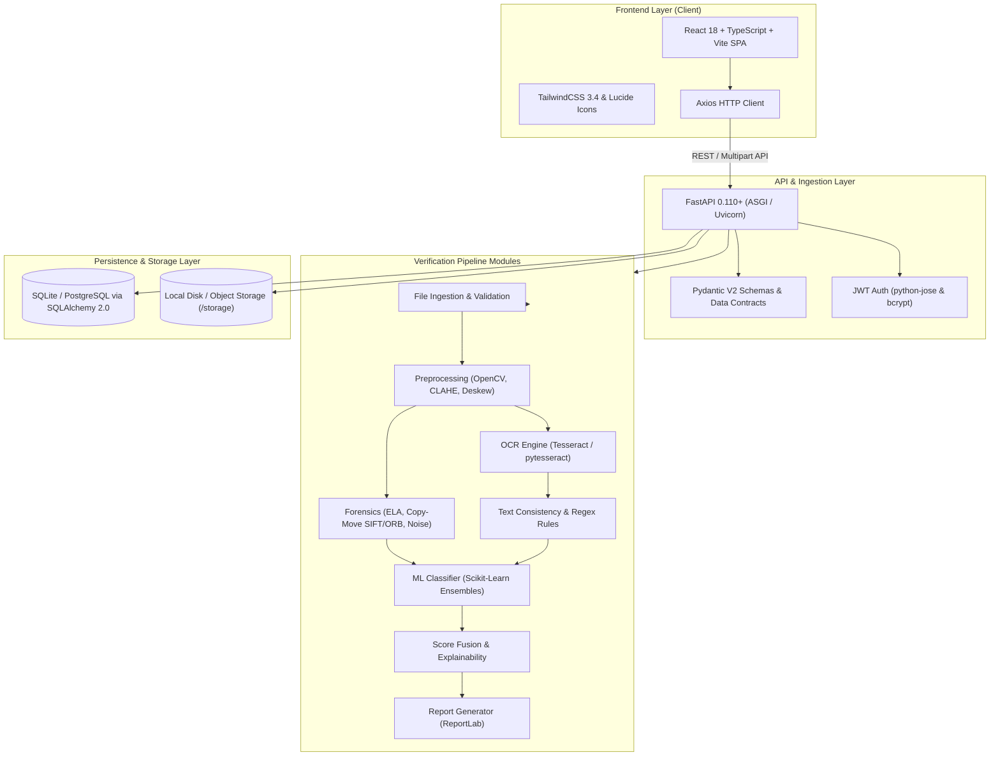

# Technology Stack Specification
## AI-Based Detection of Fake or Manipulated Academic Certificates

**Document Version:** 1.0  
**Project Authority:** Authoritative Project Standard  
**Last Updated:** September 2026  

---

## 1. Executive Summary & Architecture Overview

The platform uses a decoupled, micro-service ready architecture consisting of a **React + Vite + TypeScript** single-page application (SPA) frontend and a high-performance **FastAPI (Python 3.11+)** asynchronous backend. The backend executes a multi-stage sequential verification pipeline comprising computer vision, forensic image processing, optical character recognition (OCR), text consistency validation, and multimodal machine learning risk score fusion.

---

## 2. Technology Stack Breakdown

### 2.1 Frontend Stack

| Category | Technology | Version | Purpose / Role |
|---|---|---|---|
| **Core Framework** | [React](https://react.dev) | `^18.2.0` | UI component tree, reactive state, and rendering |
| **Language** | [TypeScript](https://www.typescriptlang.org) | `^5.2.2` | Strict end-to-end typing, interface safety |
| **Build & Dev Tool** | [Vite](https://vitejs.dev) | `^5.1.6` | Fast HMR development server and optimized rollup bundler |
| **Styling & Design** | [TailwindCSS](https://tailwindcss.com) | `^3.4.1` | Utility-first responsive design, dark/light theme |
| **CSS Processors** | PostCSS, Autoprefixer | `^8.4.35`, `^10.4.18` | Vendor prefixing and CSS transformation |
| **Routing** | [React Router DOM](https://reactrouter.com) | `^6.22.3` | Client-side routing for SPA views (Upload, Results, History, Admin) |
| **Icons** | [Lucide React](https://lucide.dev) | `^0.358.0` | Modern, consistent iconography |
| **HTTP Client** | [Axios](https://axios-http.com) | `^1.6.8` | REST API communication, multipart file upload handling |
| **UI Class Helpers** | `clsx`, `tailwind-merge` | `^2.1.0`, `^2.2.1` | Conditional class manipulation and Tailwind conflict resolution |

---

### 2.2 Backend API & Core Framework

| Category | Technology | Version | Purpose / Role |
|---|---|---|---|
| **Runtime / Language** | [Python](https://www.python.org) | `>=3.11` | High-performance backend execution environment |
| **Web Framework** | [FastAPI](https://fastapi.tiangolo.com) | `>=0.110.0` | Async REST API endpoints, dependency injection, OpenAPI documentation |
| **ASGI Server** | [Uvicorn](https://www.uvicorn.org) | `>=0.28.0` | Lightning-fast ASGI web server implementation |
| **Data Validation** | [Pydantic V2](https://docs.pydantic.dev/latest/) | `>=2.6.4` | Strict request/response validation and canonical data contracts |
| **Environment Settings**| `pydantic-settings` | `>=2.2.1` | Type-safe `.env` and environment configuration loading |
| **Multipart Handling** | `python-multipart` | `>=0.0.9` | Streaming multipart file uploads (JPG, PNG, PDF) |
| **ORM & Database** | [SQLAlchemy](https://www.sqlalchemy.org) | `>=2.0.28` | Modern declarative ORM and database abstraction layer |
| **Schema Migrations** | [Alembic](https://alembic.sqlalchemy.org) | `>=1.13.1` | Database schema migrations and version control |
| **Security / JWT** | `python-jose[cryptography]` | `>=3.3.0` | Stateless JSON Web Token creation and verification |
| **Password Hashing** | `passlib[bcrypt]`, `bcrypt` | `>=1.7.4`, `>=4.0.1`| Secure salt-and-hash password management for admin/users |

---

### 2.3 Computer Vision, OCR & Forensics Engine

| Category | Technology | Version | Purpose / Role |
|---|---|---|---|
| **Image Processing** | [OpenCV (`opencv-python-headless`)](https://opencv.org) | `>=4.9.0.80` | Image transformation, deskewing, noise reduction, contour detection |
| **Scientific Computing**| [NumPy](https://numpy.org), [SciPy](https://scipy.org) | `>=1.26.4`, `>=1.12.0`| High-speed matrix/tensor arithmetic, signal filtering, spatial algorithms |
| **Computer Vision Utilities** | [scikit-image](https://scikit-image.org) | `>=0.22.0` | Structural Similarity Index (SSIM), edge and texture feature analysis |
| **Image Manipulation** | [Pillow (PIL)](https://python-pillow.org) | `>=10.2.0` | Format conversion, image metadata inspection, EXIF extraction |
| **OCR Engine** | [Tesseract OCR](https://github.com/tesseract-ocr/tesseract) (`pytesseract`) | System / Wrapper | Optical character recognition, token extraction, bounding box mapping |
| **Error Level Analysis**| Custom ELA Module (PIL/NumPy) | Internal | Detects compression rate inconsistencies and localized image tampering |
| **Copy-Move Forensics** | SIFT / ORB Keypoint Matchers (OpenCV) | Internal | Detects replicated or cloned regions (stamps, signatures, marks) |

---

### 2.4 Machine Learning & Analytics

| Category | Technology | Version | Purpose / Role |
|---|---|---|---|
| **ML Framework** | [scikit-learn](https://scikit-learn.org) | `>=1.4.1.post1` | Random Forest & Gradient Boosting risk assessment models |
| **Data Manipulation** | [Pandas](https://pandas.pydata.org) | `>=2.2.1` | Data manipulation, tabular parsing, and feature matrix processing |
| **Model Serialization** | `joblib` | `>=1.3.2` | Fast persistence and deserialization of trained ML models |
| **Synthetic Generation**| [Faker](https://faker.readthedocs.io), `PyYAML` | `>=20.0.0`, `>=6.0.0` | Procedural generation of synthetic certificates and test datasets |
| **Score Fusion** | Multi-Modal Weighted Engine | Internal | Combines OCR, Forensics, Template, and ML sub-scores into 0–100 risk score |

---

### 2.5 Document Reporting & Export

| Category | Technology | Version | Purpose / Role |
|---|---|---|---|
| **PDF Generation** | [ReportLab](https://www.reportlab.com) | `>=4.1.0` | Generates official audit reports, risk breakdown tables, and tampering heatmap overlays |

---

### 2.6 Testing, Quality Assurance & Tooling

| Category | Technology | Purpose / Role |
|---|---|---|
| **Python Testing** | `pytest`, `pytest-asyncio`, `pytest-cov` | Async unit, integration, and end-to-end pipeline test runner with coverage |
| **HTTP Test Client** | `httpx` | Async client for integration testing of FastAPI endpoints |
| **Python Linter & Formatter** | [Ruff](https://astral.sh/ruff) | Extremely fast Python linting (`ruff check`) and code formatting (`ruff format`) |
| **Frontend Linter** | ESLint | TypeScript and React component linting |
| **Package Management** | `uv` / `pip` (Python), `npm` (Node.js) | Fast, deterministic dependency management |

---

## 3. Storage & Infrastructure Architecture

| Layer | Implementation | Details |
|---|---|---|
| **Primary Database** | SQLite (Development) / PostgreSQL (Production) | Stores users, verification jobs, results, templates, and audit logs |
| **Artifact / File Store** | Local Directory (`storage/`) | Dedicated folders for `uploads/`, `preprocessed/`, `forensics/`, and `reports/` |
| **Hardware Fallback** | Automatic CPU/GPU Graceful Degradation | Runs on standard CPU architectures without requiring discrete GPUs |
| **Async Task Engine** | FastAPI `BackgroundTasks` / Celery (Optional) | Handles long-running multi-stage forensic analysis without blocking the API |
