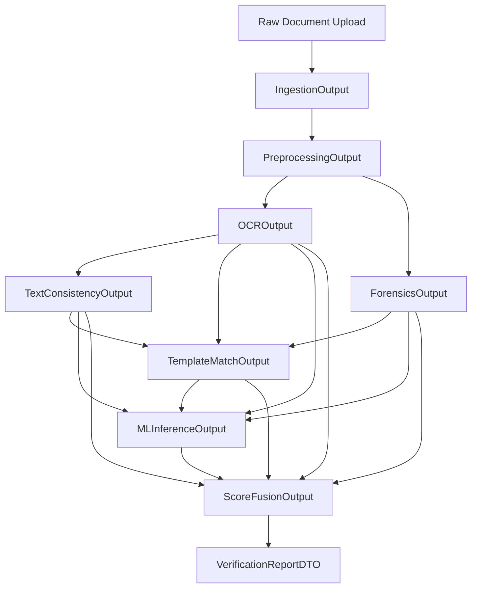

# Pipeline Data Contracts & Inter-Module Interfaces

**Document ID:** SPEC-02  
**Status:** Approved / Authoritative  
**Standard:** Pydantic V2 / TypeScript Compatible  

---

## 1. Overview & Data Flow Sequence

The certificate verification pipeline operates sequentially across stages, passing typed, validated domain models. Every module input and output must conform strictly to the Pydantic models defined herein.



---

## 2. Shared Primitive Types & Enums

```python
from enum import Enum
from typing import List, Optional, Dict, Any, Tuple
from pydantic import BaseModel, Field

class RiskBand(str, Enum):
    LOW = "LOW"
    MEDIUM = "MEDIUM"
    HIGH = "HIGH"

class CheckStatus(str, Enum):
    PASSED = "PASSED"
    WARNING = "WARNING"
    FAILED = "FAILED"
    SKIPPED = "SKIPPED"

class BoundingBox(BaseModel):
    """Normalized coordinates: 0.0 to 1.0 relative to image width and height."""
    x1: float = Field(..., ge=0.0, le=1.0, description="Top-left X")
    y1: float = Field(..., ge=0.0, le=1.0, description="Top-left Y")
    x2: float = Field(..., ge=0.0, le=1.0, description="Bottom-right X")
    y2: float = Field(..., ge=0.0, le=1.0, description="Bottom-right Y")

class PixelBoundingBox(BaseModel):
    """Absolute pixel coordinates."""
    x: int = Field(..., ge=0)
    y: int = Field(..., ge=0)
    width: int = Field(..., gt=0)
    height: int = Field(..., gt=0)
```

---

## 3. Module 1: Ingestion Output

```python
class IngestionOutput(BaseModel):
    document_id: str = Field(..., description="UUID string")
    original_filename: str
    file_extension: str  # e.g., ".jpg", ".png", ".pdf"
    mime_type: str       # e.g., "image/jpeg", "application/pdf"
    file_size_bytes: int
    raw_storage_path: str
    is_pdf: bool
    page_count: int = 1
```

---

## 4. Module 2: Preprocessing Output

```python
class PreprocessingOutput(BaseModel):
    document_id: str
    processed_image_path: str = Field(..., description="Path to clean, deskewed RGB image")
    thumbnail_path: str = Field(..., description="Small web preview image path")
    original_width: int
    original_height: int
    processed_width: int
    processed_height: int
    deskew_angle_degrees: float = Field(default=0.0, description="Angle rotated to straighten")
    contrast_applied: bool = True
    noise_reduction_applied: bool = True
```

---

## 5. Module 3: OCR & Information Extraction Output

```python
class OCRToken(BaseModel):
    text: str
    confidence: float = Field(..., ge=0.0, le=1.0)
    bbox: BoundingBox
    pixel_bbox: PixelBoundingBox

class CertificateFields(BaseModel):
    student_name: Optional[str] = None
    student_name_confidence: float = 0.0

    register_number: Optional[str] = None
    register_number_confidence: float = 0.0

    institution_name: Optional[str] = None
    institution_name_confidence: float = 0.0

    course_degree: Optional[str] = None
    course_degree_confidence: float = 0.0

    grade_or_marks: Optional[str] = None
    grade_or_marks_confidence: float = 0.0

    issue_date: Optional[str] = None
    issue_date_confidence: float = 0.0

    certificate_number: Optional[str] = None
    certificate_number_confidence: float = 0.0

class OCROutput(BaseModel):
    document_id: str
    engine_used: str = Field(default="pytesseract", description="'pytesseract' or 'easyocr'")
    raw_extracted_text: str
    average_ocr_confidence: float = Field(..., ge=0.0, le=1.0)
    tokens: List[OCRToken] = Field(default_factory=list)
    fields: CertificateFields
    low_confidence_flag: bool = False
```

---

## 6. Module 4: Text Consistency Analysis Output

```python
class ConsistencyCheckItem(BaseModel):
    rule_id: str          # e.g., "RULE_DATE_LOGIC", "RULE_GRADE_FORMAT"
    name: str             # Human-readable rule name
    status: CheckStatus
    confidence: float = Field(default=1.0, ge=0.0, le=1.0)
    details: str          # Explanation of findings
    field_affected: Optional[str] = None

class TextConsistencyOutput(BaseModel):
    document_id: str
    overall_status: CheckStatus
    consistency_risk_score: float = Field(..., ge=0.0, le=100.0, description="0=Clean, 100=Inconsistent")
    checks: List[ConsistencyCheckItem] = Field(default_factory=list)
```

---

## 7. Module 5: Image Forensics Output

```python
class SuspiciousRegion(BaseModel):
    region_id: str
    bbox: BoundingBox
    pixel_bbox: PixelBoundingBox
    forensic_type: str = Field(..., description="e.g. 'ELA_ANOMALY', 'COPY_MOVE', 'FONT_MISMATCH'")
    anomaly_score: float = Field(..., ge=0.0, le=1.0)
    description: str

class ForensicsOutput(BaseModel):
    document_id: str
    ela_heatmap_path: str
    ela_score: float = Field(..., ge=0.0, le=1.0, description="0=Consistent compression, 1=Heavy splicing")
    
    copy_move_detected: bool = False
    copy_move_clusters_count: int = 0
    copy_move_score: float = Field(..., ge=0.0, le=1.0)
    
    font_irregularity_score: float = Field(..., ge=0.0, le=1.0)
    noise_inconsistency_score: float = Field(..., ge=0.0, le=1.0)
    
    forensics_risk_score: float = Field(..., ge=0.0, le=100.0)
    suspicious_regions: List[SuspiciousRegion] = Field(default_factory=list)
```

---

## 8. Module 6: Template & Record Match Output

```python
class TemplateMatchOutput(BaseModel):
    matched_template_id: Optional[str] = None
    matched_template_name: Optional[str] = None
    layout_similarity_score: Optional[float] = Field(None, ge=0.0, le=1.0)
    logo_signature_similarity: Optional[float] = Field(None, ge=0.0, le=1.0)
    template_risk_score: float = Field(default=0.0, ge=0.0, le=100.0)
    record_found: bool = False
    record_field_matches: Dict[str, bool] = Field(default_factory=dict)
```

---

## 9. Module 7: ML / DL Inference Output

```python
class MLInferenceOutput(BaseModel):
    model_version: str
    model_type: str = Field(..., description="'tabular_baseline', 'cnn_visual', or 'fused_multimodal'")
    manipulation_probability: float = Field(..., ge=0.0, le=1.0)
    predicted_class: str = Field(..., description="'genuine' or 'manipulated'")
    feature_contributions: Dict[str, float] = Field(default_factory=dict, description="SHAP/Feature weights")
    gradcam_heatmap_path: Optional[str] = None
```

---

## 10. Module 8: Score Fusion & Final Report DTO

```python
class ContributingFactor(BaseModel):
    factor_id: str
    category: str        # 'FORENSICS', 'TEXT_CONSISTENCY', 'OCR', 'ML_MODEL', 'TEMPLATE'
    impact: str          # 'LOW', 'MEDIUM', 'HIGH'
    weight_percentage: float
    description: str

class ScoreFusionOutput(BaseModel):
    document_id: str
    overall_risk_score: float = Field(..., ge=0.0, le=100.0)
    risk_band: RiskBand
    confidence_level: float = Field(..., ge=0.0, le=1.0)
    contributing_factors: List[ContributingFactor] = Field(default_factory=list)

class VerificationReportDTO(BaseModel):
    verification_id: str
    document_id: str
    timestamp: str
    verifier_username: str
    risk_score: float
    risk_band: RiskBand
    extracted_fields: CertificateFields
    consistency_results: TextConsistencyOutput
    forensics_results: ForensicsOutput
    template_results: Optional[TemplateMatchOutput] = None
    ml_results: MLInferenceOutput
    contributing_factors: List[ContributingFactor]
    summary_verdict: str
    disclaimer: str = (
        "This authenticity assessment is generated by an automated AI decision-support system. "
        "It provides a risk evaluation and does not constitute a definitive legal confirmation."
    )
```
