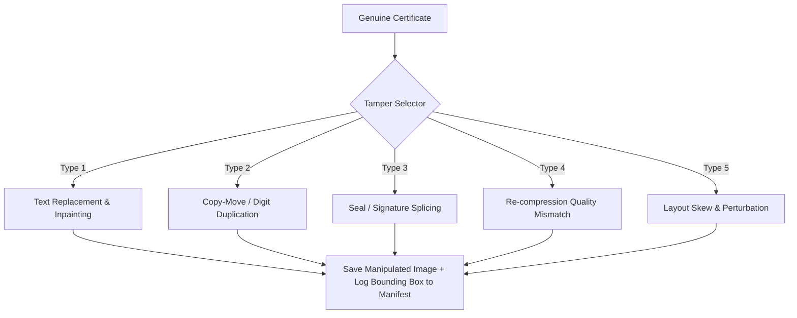

# Dataset & Synthesis Engine Specification

**Document ID:** SPEC-04  
**Status:** Approved / Authoritative  
**Domain:** Synthetic Data Generation, Dataset Layout, and Ground Truth Annotations  

---

## 1. Purpose

Machine learning models require balanced, ground-truth labeled datasets of both genuine and forged certificates. Because real-world forged certificates are rare and contain PII, this specification defines the programmatic **Synthetic Manipulation Engine** that systematically generates realistic forged certificates from genuine base templates.

---

## 2. Directory Hierarchy

```text
datasets/
├── raw/                         # Genuine base templates / anonymized originals
│   ├── template_univ_a.png
│   ├── template_univ_b.png
│   └── templates_meta.json
├── assets/                      # Graphic assets for splicing
│   ├── seals/                   # Extracted clean seals
│   │   ├── seal_01.png
│   │   └── seal_02.png
│   ├── signatures/              # Extracted transparent PNG signatures
│   │   ├── sig_01.png
│   │   └── sig_02.png
│   └── fonts/                   # Open-source TrueType fonts
│       ├── TimesNewRoman.ttf
│       ├── Arial.ttf
│       ├── Georgia.ttf
│       └── CourierNew.ttf
├── synthetic_manipulated/       # Generated forged certificates
│   ├── train/
│   ├── val/
│   └── test/
└── ground_truth/
    ├── train_manifest.json
    ├── val_manifest.json
    └── test_manifest.json
```

---

## 3. Synthetic Manipulation Engine Architecture

The generation script (`src/data/synthesis_engine.py`) takes a genuine certificate and applies one or more of five distinct tamper transformations:



### 3.1 Manipulation Type 1: Text Replacement (Field Tampering)
1. Select target field (e.g. `student_name`, `cgpa`, `issue_date`).
2. Identify bounding box $[x, y, w, h]$.
3. Inpaint the area using OpenCV Navier-Stokes or Telea algorithm:
   ```python
   mask = np.zeros(img.shape[:2], dtype=np.uint8)
   mask[y : y + h, x : x + w] = 255
   inpainted = cv2.inpaint(img, mask, inpaintRadius=3, flags=cv2.INPAINT_TELEA)
   ```
4. Render new synthesized text with either:
   - **Matched Font:** Font matching original style and size.
   - **Mismatched Font:** Deliberately offset font family, size (+/- 2pt), or vertical baseline (+/- 3px).

### 3.2 Manipulation Type 2: Copy-Move Cloning
1. Crop a source patch (e.g., the digit "9" or "0" from marks column).
2. Paste it over another digit location within the same certificate.
3. Apply slight Gaussian blur ($\sigma = 0.5$) along borders to simulate manual smoothing.

### 3.3 Manipulation Type 3: Splicing with Poisson Blending
1. Select external seal or signature from `datasets/assets/`.
2. Determine target paste location $[x, y]$.
3. Apply seamless cloning:
   ```python
   output = cv2.seamlessClone(src_patch, target_img, mask, center_point, cv2.NORMAL_CLONE)
   ```

### 3.4 Manipulation Type 4: Compression Artifact Discrepancy
1. Crop manipulated region $[x, y, w, h]$.
2. Save crop as JPEG with low quality factor ($Q = 65$).
3. Paste back into high-quality original ($Q = 95$) to produce distinct local ELA quantization noise.

---

## 4. Ground-Truth Manifest Annotation Schema

Every generated image is cataloged in the respective split JSON manifest:

```json
{
  "dataset_version": "1.0.0",
  "generated_at": "2026-09-16T12:00:00Z",
  "total_samples": 1000,
  "samples": [
    {
      "sample_id": "SYNTH_FORGED_00042",
      "split": "train",
      "image_path": "datasets/synthetic_manipulated/train/SYNTH_FORGED_00042.png",
      "is_manipulated": true,
      "primary_label": "manipulated",
      "manipulation_types": ["TEXT_REPLACEMENT", "RECOMPRESSION"],
      "manipulated_regions": [
        {
          "region_id": "REG_01",
          "field_affected": "cgpa_marks",
          "original_value": "7.12",
          "tampered_value": "9.85",
          "bbox_pixel": { "x": 420, "y": 680, "width": 85, "height": 28 },
          "bbox_normalized": { "x1": 0.42, "y1": 0.68, "x2": 0.505, "y2": 0.708 },
          "technique": "INPAINT_AND_REPLACE",
          "font_mismatched": true
        }
      ],
      "source_template": "template_univ_a.png",
      "base_resolution": [1920, 1080]
    }
  ]
}
```

---

## 5. Dataset Splitting & Balance Guidelines

1. **Balance Ratio:** 50% Genuine, 50% Manipulated.
2. **Split Distribution:**
   - **Train:** 70%
   - **Validation:** 15%
   - **Test:** 15%
3. **Template Independence:**
   The test split **must** include at least one institutional template family *never* seen during training to evaluate the model's out-of-distribution generalization capability.
