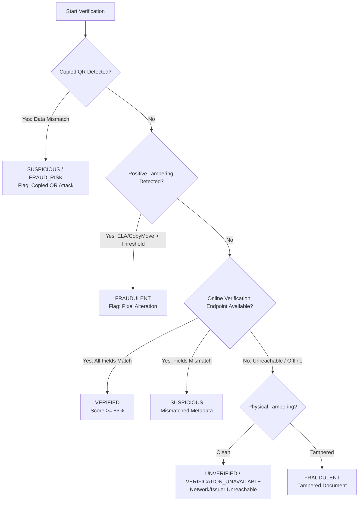

# Verification Logic & Explainability Engine

**Authoritative Specification for Authenticity Scoring, Status Resolution, and Copied QR Detection**  
**Project:** AI-Based Detection of Fake or Manipulated Academic Certificates  
**Path:** `docs/verification_logic.md`  

---

## 1. Principles of Verification & Fair Judgment

1. **Evidence-Based Verdicts**: The system never outputs a bald judgment (e.g., "FAKE") without detailing exact corroborating physical or digital evidence.
2. **Never Assume Fraud from Network Downtime**: If an issuer verification endpoint is down, times out, or returns HTTP 404/500, the status resolves to **`UNVERIFIED / VERIFICATION_UNAVAILABLE`**, never `FRAUDULENT`, unless positive physical tampering is independently proven.
3. **Never Assume Authenticity Solely from Valid QR**: A copied QR code from a genuine certificate pasted onto a fraudulent certificate must be intercepted via cross-modal field matching.

---

## 2. Configurable Authenticity Score Formulation

The final **Authenticity Score** ($S \in [0.0, 100.0]$) is computed through a 6-component weighted linear combination:

$$S = w_1 \cdot C_{\text{online}} + w_2 \cdot C_{\text{match}} + w_3 \cdot C_{\text{forensics}} + w_4 \cdot C_{\text{qr}} + w_5 \cdot C_{\text{domain}} + w_6 \cdot C_{\text{sig}}$$

| Component | Weight | Max Score | Basis of Calculation |
|---|---|---|---|
| **Online Record Verification** ($C_{\text{online}}$) | **25%** | 25.0 pts | HTTP accessibility, official registry response, certificate status |
| **Field Consistency Matching** ($C_{\text{match}}$) | **25%** | 25.0 pts | Fuzzy name match, exact ID match, course title, date alignment |
| **Document Integrity Forensics** ($C_{\text{forensics}}$) | **20%** | 20.0 pts | Inverse ELA error, copy-move score, noise consistency |
| **QR Code Integrity** ($C_{\text{qr}}$) | **15%** | 15.0 pts | Detection confidence, payload decodability, clean syntax |
| **Issuer & Domain Trust** ($C_{\text{domain}}$) | **10%** | 10.0 pts | Registered domain vs. untrusted/suspicious domain TLD |
| **Signature & Seal Evidence** ($C_{\text{sig}}$) | **5%** | 5.0 pts | Signatory stroke presence, institutional crest contours |

The **Fraud Risk Score** is the complementary calibrated risk:
$$\text{Fraud Risk Score} = 100.0 - S$$

---

## 3. Status Determination Matrix



### 3.1 Verdict Definitions
- 🟢 **`VERIFIED`**:
  Official online registry accessible, certificate ID matched, candidate name matched, course name matched, and pixel forensics confirm clean document integrity.
- 🟡 **`SUSPICIOUS`**:
  Valid QR code resolved, but one or more critical fields mismatch (Copied QR Attack), OR localized anomalies detected around the signatory/name zone.
- 🔴 **`FRAUDULENT`**:
  Direct evidence of copy-move cloning, multi-field text splicing, fraudulent issuer domain masquerading, or multiple contradictory digital signatures.
- ⚪ **`UNVERIFIED / VERIFICATION_UNAVAILABLE`**:
  Document possesses no machine-readable QR code or the issuer's verification server is unreachable, while physical forensics show no signs of manipulation.

---

## 4. Specific Attack Defense: Copied QR Interception

### Attack Scenario
A counterfeiter steals an authentic Coursera certificate belonging to *John Doe* with Certificate ID `UC-99999`. The counterfeiter edits the certificate image to show *Jane Smith* with Certificate ID `UC-11111`, but retains the original valid QR code.

### Interception Routine
1. QR Code detector successfully extracts URL: `https://coursera.org/verify/UC-99999`.
2. Safe URL client queries Coursera registry, receiving record:
   - Name: `John Doe`
   - Cert ID: `UC-99999`
3. Cross-modal comparator aligns OCR certificate tokens:
   - Certificate OCR Name: `Jane Smith`
   - Certificate OCR ID: `UC-11111`
4. Discrepancy analysis triggers:
   $$\text{Name Match Score} = 12.0\% < 80.0\%$$
   $$\text{Cert ID Match Score} = 0.0\% < 100.0\%$$
5. Rule activation:
   ```python
   if qr_valid and (name_match_score < 0.70 or cert_id_match_score < 0.85):
       copied_qr_detected = True
       status = "SUSPICIOUS"  # or FRAUDULENT
       reasons.append("VALID_QR_BUT_CERTIFICATE_DATA_MISMATCH: QR belongs to credential UC-99999 (John Doe), but document claims UC-11111 (Jane Smith).")
   ```
